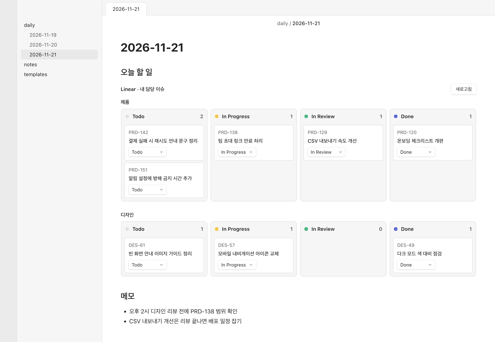

# Linear Daily Board

[English](README.md)

옵시디언의 일일노트 본문에서 내 Linear 이슈를 팀별 칸반으로 보고, 카드를 다른 열로 옮겨 상태를 변경합니다.

<picture>
  <source media="(prefers-color-scheme: dark)" srcset="https://raw.githubusercontent.com/lightpurple/obsidian-linear-board/main/docs/board-dark-ko.png">
  
</picture>

## 연결

옵시디언 1.11.4 이상에서 플러그인을 활성화합니다. 일일노트의 **Linear 연결**을 누르고 이슈 읽기와 수정 권한이 있는 개인 API 키를 입력합니다. 키는 옵시디언 비밀 저장소에 보관합니다. 키를 바꾸려면 설정에서 **Linear Daily Board**를 엽니다. [Linear API 안내](https://linear.app/developers/graphql)

## 일일노트에서 사용하기

일일노트나 일일노트 양식에 아래 블록을 넣고 읽기 보기 또는 라이브 프리뷰로 엽니다.

````markdown
## 오늘 할 일

```linear-board
```
````

- 보드는 현재 사용자에게 배정된 보관 처리 전 이슈를 가져옵니다. 각 팀의 워크플로 상태가 열이 됩니다. 카드를 같은 팀의 다른 열로 끌거나 카드의 상태 메뉴를 사용하세요. 이슈 제목을 누르면 오른쪽 사이드바의 웹 뷰어에서 Linear 원본이 열립니다. 이 기능을 쓰려면 코어 플러그인 ‘웹 뷰어’를 켜야 합니다.
- 상태 변경은 바로 전송합니다. 열려 있는 보드는 약 1분마다 갱신하며 **새로고침**으로 즉시 다시 조회할 수 있습니다. 저장 응답이 끊기면 Linear에서 상태를 다시 확인합니다. 시스템의 중복 상태는 Linear에서 중복 이슈를 지정하면 반영됩니다.
- 보드는 어느 날짜의 노트에서 열어도 항상 현재 상태를 표시합니다.
- 칸반 열이 넉넉하게 보이도록 일일노트는 패널 폭에 맞춰 넓게 표시합니다. 일일노트인지는 코어 플러그인 **일일 노트**에 설정된 폴더와 날짜 형식으로 판단합니다.
- 설정에서 보드에 표시할 팀과 상태 열을 고를 수 있습니다.
- 화면은 한국어와 영어를 지원합니다. 설정의 **언어**에서 직접 고르기 전까지는 옵시디언의 언어 설정을 따릅니다.

## 빌드 및 설치

Node.js 22.18 이상에서 다음 명령을 실행합니다.

```sh
npm ci
npm test
npm run build
```

`main.js`, `manifest.json`, `styles.css`를 설치하려는 볼트의 `.obsidian/plugins/linear-daily-board/`에 복사한 뒤 옵시디언 설정에서 플러그인을 활성화합니다.

## 라이선스

[MIT](LICENSE)
