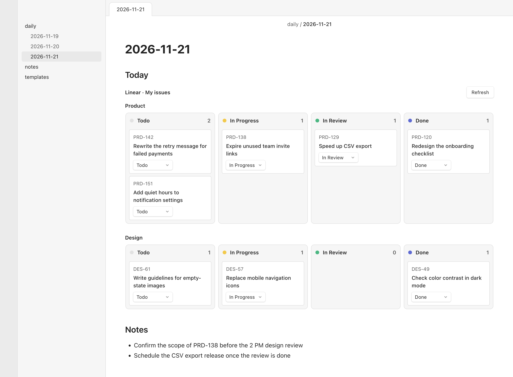

# Linear Daily Board

[한국어](README.ko.md)

An Obsidian plugin that shows your assigned Linear issues as a kanban board inside daily notes. Move a card to another column to change the issue's status in Linear.

<picture>
  <source media="(prefers-color-scheme: dark)" srcset="docs/board-dark-en.png">
  
</picture>

## Connect to Linear

Enable the plugin in Obsidian 1.11.4 or later. In a daily note, click **Connect Linear** and enter a personal API key that can read and update issues. The key is kept in Obsidian's secret storage. To change the key, open **Linear Daily Board** in the plugin settings. See the [Linear API documentation](https://linear.app/developers/graphql).

## Use it in a daily note

Add the block below to a daily note or to your daily note template, then open the note in Reading view or Live Preview.

````markdown
## Today

```linear-board
```
````

- The board loads the unarchived issues assigned to you. Each team's workflow states become the columns. Drag a card to another column of the same team, or use the status menu on the card. Click an issue title to open it in the web viewer in the right sidebar. This requires the core plugin **Web viewer**.
- Status changes are sent right away. An open board refreshes about once a minute, and **Refresh** reloads it immediately. If a save response is lost, the plugin checks the status in Linear again. The system "Duplicate" status is applied when you mark an issue as a duplicate in Linear.
- The board always shows the current state, whichever date the note is for.
- In the settings, you can choose which team and which status columns the board shows.
- The interface is available in English and Korean. It follows Obsidian's language until you pick one under **Language** in the settings.

## Build and install

Run the following commands with Node.js 22.18 or later.

```sh
npm ci
npm test
npm run build
```

Copy `main.js`, `manifest.json` and `styles.css` to `.obsidian/plugins/linear-daily-board/` in your vault, then enable the plugin in the Obsidian settings.

## License

[MIT](LICENSE)
